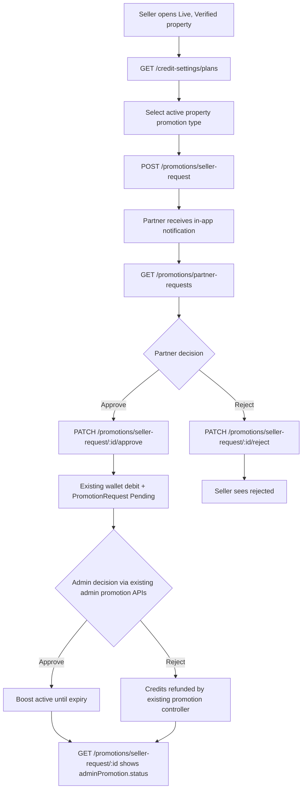

# DigiNiwas — Seller-to-Partner Property Boost API (frontend handoff)

Base URL: `/api/v1`. Auth: `Authorization: Bearer <JWT>` for all seller-request endpoints.

## Flow



## GET `/api/v1/credit-settings/plans`
No request body. Returns only active admin-managed products. Sample response (illustrative, not live pricing):
```json
{"success":true,"data":{"creditsPerRupee":1,"version":2,"plans":[{"code":"PROPERTY_BOOST","name":"Property Boost","credits":500,"durationDays":7,"targetType":"PROPERTY"}]}}
```
Use only codes `PROPERTY_BOOST`, `FEATURED_7_DAYS`, `LOCALITY_TOP_30_DAYS` when submitting a property boost. Plan price is **not** accepted from the client: backend obtains current credit price.

## POST `/api/v1/promotions/seller-request`
Seller JWT. JSON request:
```json
{"propertyId":"507f1f77bcf86cd799439011","promotionType":"PROPERTY_BOOST","message":"Please boost this property"}
```
Optional `partnerId` must match the property's assigned partner, otherwise 403. The backend infers the seller from JWT and verifies listing ownership, Live/Verified status and assignment. **No credit debit on submission.**
201 response:
```json
{"success":true,"message":"Boost request sent to assigned partner","data":{"_id":"507f191e810c19729de860ea","sellerId":"...","propertyId":"...","partnerId":"...","promotionType":"PROPERTY_BOOST","creditPriceAtRequest":500,"status":"PendingPartner"}}
```
`creditPriceAtRequest` is informative. Debit uses Admin's current price at Partner acceptance (may differ if Admin changes pricing).

## GET `/api/v1/promotions/partner-requests`
Partner JWT. No payload. Response: `{ "success": true, "data": [ { "_id": "...", "propertyId": { "title": "..." }, "promotionType": "PROPERTY_BOOST", "status": "PendingPartner", "creditPriceAtRequest": 500 } ] }`.

## PATCH `/api/v1/promotions/seller-request/:id/approve`
Partner JWT; no request body needed. The route validates current assignment and invokes the **existing** property promotion request handler, which debits credits transactionally, adds the Admin-pending PromotionRequest, and notifies Admin. Response:
```json
{"success":true,"message":"Partner approved; credits reserved; Admin review pending","data":{"request":{"_id":"...","status":"PendingAdmin","promotionRequestId":"..."},"promotionRequest":{"_id":"...","status":"Pending","creditsCharged":500},"wallet":{"...":"..."}}}
```
Possible failures: 400 insufficient credits/inactive plan; 403 incorrect role; 409 request already decided, duplicate promotion, reassigned/unavailable property.

## PATCH `/api/v1/promotions/seller-request/:id/reject`
Partner JWT. JSON: `{ "reason": "Not enough marketing budget right now" }`.
Response: `{ "success": true, "data": { "_id": "...", "status": "RejectedByPartner", "rejectionReason": "..." } }`.

## GET `/api/v1/promotions/seller-requests`
Seller JWT. Returns `{ "success": true, "data": [ ... ] }` for seller's own requests.

## GET `/api/v1/promotions/seller-request/:id`
Seller, assigned Partner or Admin JWT. Returns `data` with seller request and `adminPromotion` containing `status`, `creditsCharged`, `expiresAt`, `approvedAt`, and `adminRemarks` once the Partner has approved. **Use `adminPromotion.status` as the source of truth for final activation or rejection** (`Pending`, `Approved`, `Rejected`, `Expired`); the seller request `status` remains `PendingAdmin` for that stage.

## Existing Admin promotion APIs (unchanged)
- `PATCH /api/v1/promotions/:promotionRequestId/approve` body `{"remarks":"Approved"}`
- `PATCH /api/v1/promotions/:promotionRequestId/reject` body `{"remarks":"Rejected"}`
- `GET /api/v1/promotions` Admin listing

## Important deployment/testing notes
- Current implementation assumes JWT role values `seller` / `owner` and `partner` and seller-owned properties have `addedBy.role` Seller/Owner plus `addedBy.userId` matching seller JWT. Confirm actual production JWT and property ownership convention.
- MongoDB transactions require a replica set. Existing promotion debit flows depend on transactions too.
- Existing promotion controller already sends Admin notifications and handles refunds on Admin rejection. Seller gets a notification at Partner request acceptance/rejection but final Admin outcome is available through request detail; automatic Seller final-outcome push is not yet wired.
- A request stuck at `Processing` after a server crash requires reconciliation with existing `PromotionRequest` and wallet ledger before retry; do not blindly resubmit a second debit.
- Duplicate concurrent seller submissions are checked but are not enforced through a unique partial DB index; frontend should disable repeat submit and backend may need a production idempotency upgrade.
- This update was syntax checked, **not integration tested against live MongoDB or Firebase**.
